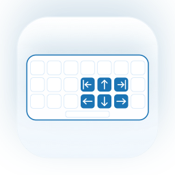
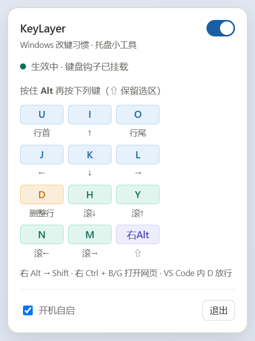

# KeyLayer（键层）

<p align="center">
  
</p>

<p align="center">
  把 Windows 上 <code>Alt + i/j/k/l/u/o</code> 的改键习惯带到 macOS 与 Windows 的常驻小工具。
</p>

<p align="center">
  
</p>

<p align="center">
  Windows 托盘面板（Tauri v2）· macOS 版为菜单栏 SwiftUI 应用
</p>

<p align="center">
  <a href="https://github.com/SkyblueeeLabs/keylayer/actions/workflows/ci.yml"></a>
  
  <a href="LICENSE"></a>
</p>

> 原名 `KeyMap`，2026 年 11 月更名为 **KeyLayer（键层）**。

项目起点是一次**自有软件的功能恢复**：原来在 Windows 上用的是一个 AutoHotkey 编译的 `KeyMap.exe`，脚本源码一度丢失。后来从 exe 的资源段里找回了明文 AHK 脚本，据此在 macOS 上用 Swift + `CGEventTap` 重建了核心行为，再按同一份行为规格用 **Tauri v2（Rust + WebView2）** 重写了 Windows 版。完整取证记录见 [`docs/REVERSE_ENGINEERING.md`](docs/REVERSE_ENGINEERING.md)。

两端**共用一份规格**（[`spec/keybindings.json`](spec/keybindings.json)）与 40 项回归用例，平台层各写一份：macOS 用 `CGEventTap`，Windows 用 `WH_KEYBOARD_LL`。

## 目录

- [功能](#功能)
- [平台支持](#平台支持)
- [Windows 版](#windows-版)
- [macOS 版](#macos-版)
- [双端架构](#双端架构)
- [构建与测试](#构建与测试)
- [已知限制](#已知限制)
- [隐私与安全](#隐私与安全)
- [许可范围](#许可范围)
- [贡献](#贡献)

---

## 功能

触发修饰键：macOS 是 **⌥（Option）或 ⌘（Command）**；Windows 是 **Alt**。加 **Shift** 会保留选区。

| 按键 | 输出 | 说明 |
| --- | --- | --- |
| `i` | `↑` | 上 |
| `j` | `←` | 左 |
| `k` | `↓` | 下 |
| `l` | `→` | 右 |
| `u` | 行首 | macOS `⌘←` / Windows `Home` |
| `o` | 行尾 | macOS `⌘→` / Windows `End` |
| `d` | 删除整行 | 破坏性操作；在 VS Code 内放行原键 |
| `h` / `y` | 垂直滚轮下 / 上 | |
| `n` / `m` | 水平滚轮左 / 右 | |
| 右 `⌥` / 右 `Alt` | `⇧` | 右 Alt 当作 Shift 用 |
| 右 `⌃` + `b` / `g` | 打开百度 / Google | Windows 版已接通；macOS 版由 `rightControl` 状态实现 |

- **Ctrl / Control 组合一律放行**，避免误伤系统快捷键。
- macOS `--cmd-only` 可让所有映射只认 ⌘，把 ⌥ 还给特殊字符输入。
- 两端都有**生效开关**、状态灯和 VS Code 白名单（白名单作用于 `Alt+D`）。

### Caps Lock

原 Windows 脚本把 Caps Lock 映射成 Esc。两端都建议用系统设置实现，不写进程序：

1. 关闭「使用大写锁定键切换输入法」；
2. 把 Caps Lock 设为 **Escape**；
3. 输入法切换用 `Ctrl+空格`。

---

## 平台支持

| | macOS | Windows |
| --- | --- | --- |
| 状态 | 已完成，长期使用 | 已完成，2026-11 真机验证 |
| 实现 | Swift + `CGEventTap` | Rust + Tauri v2 + `WH_KEYBOARD_LL` |
| 界面 | 菜单栏 `NSStatusItem` + `NSPopover`（SwiftUI） | 托盘图标 + 无边框置顶 WebView2 面板 |
| 触发键 | ⌘ 或 ⌥ | Alt |
| 行首 / 行尾 | `⌘←` / `⌘→` | `Home` / `End` |
| 删除整行 | 合成 `⌘` 键序列 | 合成 `Home / Shift+End / Shift+→ / Backspace / Home` |
| 前台白名单 | `NSWorkspace` bundle id | `GetForegroundWindow` + 进程名 |
| 开机自启 | `SMAppService` | 官方 autostart 插件（HKCU Run） |
| 权限 | 辅助功能 / 输入监控 | 无需额外授权（全局钩子） |
| 分发 | 自行构建 `.app` | NSIS / MSI 安装包，或单文件便携版 |

> Windows 版不是给老 `KeyMap.exe` 套壳，也不再内嵌 GPLv2 的 AutoHotkey 解释器；它是按行为规格重写的独立实现，可按 MIT 授权。

---

## Windows 版

### 运行

- **安装包**：`windows/src-tauri/target/release/bundle/` 下的 NSIS `*-setup.exe` 或 MSI。
- **便携版**：`windows/src-tauri/target/release/keylayer.exe`，**单个 exe 即可**，不需要同目录 DLL；前端、图标均已嵌入。
- 系统要求：Windows 10/11 x64 + **WebView2 Runtime**（Win11 自带；Win10 一般随 Edge 已安装）。没有 WebView2 时面板会空白。

单次点击托盘图标开 / 关面板；面板右上角可停用映射，底部可设置开机自启或退出。

> 把便携版挪到其他目录后，如果之前开过「开机自启」，需要在新位置重新勾选一次——注册表 Run 项记录的是绝对路径。

### 已验证

| 项 | 结果 |
| --- | --- |
| 11 条 Alt 映射（方向 / 行首行尾 / 删整行 / 滚轮） | 通过 |
| Shift + Alt 保留选区 | 通过 |
| 右 Alt → Shift | 通过 |
| 右 Ctrl + B 打开百度 | 通过 |
| Alt+Tab / Alt+F4 透传 | 通过 |
| 托盘单击开 / 关（不闪退） | 通过 |
| 停用后不再映射、重启保留状态 | 通过 |
| 开机自启写入 / 删除 HKCU Run | 通过 |
| Rust 复用共享 40 项用例 | 3/3 通过 |

完整记录、调试环境变量和仍未自动化的项见 [`windows/README.md`](windows/README.md)。

### 两个 Windows 平台坑

1. **Alt 必须先暂扣。** 直接把左 Alt 透传给目标应用会让它进入菜单模式，随后合成的 Home / 方向键会被菜单吃掉。现在命中映射时目标完全看不到 Alt；Alt+Tab、Alt+F4 等非映射组合才补发 Alt。
2. **方向 / Home / End 必须带扩展键标志。** `SendInput` 不加 `KEYEVENTF_EXTENDEDKEY` 时，删整行只会删掉换行符，不会删掉整行。

---

## macOS 版

### 快速开始

环境要求：macOS 13+、Xcode Command Line Tools；Apple Silicon / Intel 均可（产物默认 arm64，源码无架构依赖）。

```bash
git clone https://github.com/SkyblueeeLabs/keylayer.git
cd keylayer

# 一条命令从源码构建 CLI + App（含图标生成与签名）
bash scripts/build.sh

# 先跑纯逻辑自测（不需要权限）
./KeyLayer --self-test

# 从访达双击，或在自己的终端里：
open "$PWD/KeyLayer.app"
```

首次运行需要授权：

1. 系统设置 → 隐私与安全性 → **设备控制与数据访问**（macOS 27 里「辅助功能」的新名称）→ 勾选 `KeyLayer`；
2. 系统设置 → 隐私与安全性 → **输入监控** → 勾选 `KeyLayer`；
3. 弹窗选「退出并重新打开」。

### 权限与签名

**TCC 按代码签名身份授权，不是按路径。** `codesign -s -`（ad-hoc）的 designated requirement 是二进制 `cdhash`，每次重建都会变，会出现「明明授权了却不生效」。项目使用本地自签名证书 `KeyLayer Local Dev` 稳定身份；首次创建证书：

```bash
bash scripts/fix-permissions.sh
```

它会退出旧实例、`tccutil reset`、按需生成并导入证书、重签 App，并从当前终端启动。若弹出钥匙串授权，点「始终允许」。

经验：权限变更后 TCC 结果按进程缓存，需要退出重开；反复重建可能留下多条同名授权记录，建议用系统设置里的「−」删干净；`fix-permissions.sh` 是一次性修复，不是启动脚本。

### 其他

- CLI：`--self-test`、`--debug`、`--cmd-only`、`--session`。
- 图标：`assets/icons/` 源文件，`scripts/gen-icons.swift` 生成；菜单栏用单色模板图。
- 详细架构见本文件末尾与 [`src/KeyLayerCore.swift`](src/KeyLayerCore.swift)。

---

## 双端架构

**能共享**：行为规格、键位数据、回归用例、界面键帽数据、设计令牌。
**各写一份**：全局事件拦截、事件合成、托盘/菜单栏、权限模型、打包签名。

| 层 | 内容 | 位置 |
| --- | --- | --- |
| 唯一真相源 | 映射表、动作语义、白名单、URL、40 项用例、覆盖清单 | `spec/keybindings.json` |
| 设计令牌 | 配色、尺寸、字号、分组色 | `ui/tokens.json` |
| 代码生成 | 一次生成五份平台代码 | `scripts/gen-sources.mjs` |
| 参考实现 | 平台无关 `remap` + 40 用例 | `spec/verify.mjs` |
| 一致性门禁 | 用例、生成文件是否最新、三端是否引用生成代码 | `scripts/check.mjs` |
| macOS 适配 | `CGEventTap`、SwiftUI、`NSStatusItem`、`codesign` | `src/*.swift` |
| Windows 适配 | 低级钩子、托盘、WebView2、`SendInput` | `windows/src-tauri/` |

```
spec/keybindings.json ──> scripts/gen-sources.mjs ──┬─> src/Generated.swift
                                                   ├─> src/GeneratedTokens.swift
                                                   ├─> windows/src-tauri/src/generated.rs
                                                   ├─> ui/bindings.js
                                                   └─> ui/tokens.css
```

改键位或动作时**只改 `spec/keybindings.json`**，再跑 `npm run spec`；`npm run check` 会拦住「改了规格忘了生成」和「生成了但没引用」。改配色或尺寸只改 `ui/tokens.json`。

界面目前两套渲染：macOS 用 SwiftUI，Windows 用共享的 `ui/index.html`（WebView2）。数据层与视觉参数已经统一；浅色/深色这类运行时主题仍由各宿主注入。

---

## 构建与测试

根目录 `package.json` 提供统一入口：

```bash
npm run spec         # 从规格重新生成五份平台代码 + 一致性检查
npm run check        # 只检查（CI 用）
npm test             # 共享 40 项用例（Node 参考实现）
npm run build:mac    # 仅 macOS（生成 → CLI + App + 图标 + 签名 + 自测）
npm run build:win    # 仅 Windows（npm install + tauri build）
```

Windows 侧：

```bash
cd windows
npm install
npm run dev        # Tauri 内置 dev server，直接读项目根 ui/
npm run build      # release exe + NSIS/MSI 安装包
npm run build -- --no-bundle   # 只编译 exe
cd src-tauri && cargo test     # Rust 复用共享 40 项用例
```

macOS 侧：

```bash
bash scripts/build.sh
./KeyLayer --self-test
./KeyLayer --debug
```

Windows 真机调试环境变量（仅本机测试用）：

```bash
KEYLAYER_DEBUG_LOG=%TEMP%\kl.log KEYLAYER_ALLOW_INJECTED=1 keylayer.exe
KEYLAYER_DEBUG_KEYS=1 keylayer.exe   # 逐键记录 vk / 修饰键 / 动作
KEYLAYER_SHOW_PANEL=1 keylayer.exe   # 启动即显示面板，便于截图 / UI 自动化
```

`KEYLAYER_ALLOW_INJECTED` 默认关闭：程序会忽略其他软件合成的按键，避免自动化脚本或远程桌面误触。

CI 会跑共享检查、macOS 编译与自测、Windows `cargo test` 和 Tauri release 构建（不打包安装器）。

---

## 已知限制

**macOS**

- 滚轮方向受「自然滚动」设置影响；
- 右 `⌥` → `⇧` 改的是 `flagsChanged`，个别应用是否完全按 Shift 处理待验证；
- `keyCode 62` 是否对应你键盘的右 Control（外接键盘可能不同）；
- `⌥D` 是破坏性操作，误触会删除整行；
- `www.google.com` 在部分地区不可达。

**Windows**

- 点面板外自动收起依赖真实前台焦点，自动化环境未完全验证；托盘开/关已验证；
- 右 Ctrl+G 与 B 共用代码，仅 B 做了外部浏览器实测（Google 在部分地区不可达）；
- `Alt+H/Y` 在 VS Code 内仍映射为滚轮（原脚本有 VS Code 分支）；
- 低级钩子对以管理员运行的前台窗口可能失效；
- 右 Alt → Shift 会占用 AltGr（原 AHK 行为相同）；
- 对外分发需要 Authenticode 签名，否则 SmartScreen 会拦；
- 暂未转发 Alt+鼠标点击（只缓冲键盘）。

**原脚本中未移植的部分**（见 [`docs/REVERSE_ENGINEERING.md`](docs/REVERSE_ENGINEERING.md)）：

- `KeyMap-translator.py` 不在仓库里，复制并翻译选区、中键上划手势两处功能缺依赖；
- 光标处「中 / A」输入法状态浮动窗（Windows `imm32` / `oleacc`）；
- 中键手势状态机（Mac 触控板无中键，动作也是 Windows 特有）；
- Win 键组合 `#o/#j/#m/#n`、F8 窗口置顶、F10 大写锁定切换、热字符串 `::tabc::`；
- 每 2 小时自动 Reload（AHK 防卡死，Swift/Rust 版不需要）。

**其他**：macOS 替换图标后若 Finder 未刷新，可 `touch KeyLayer.app`、`lsregister -f` 或重启 Finder。

---

## 路线图

- [x] 映射表配置化（`spec/keybindings.json` + 多端代码生成）
- [x] UI 参数统一（`ui/tokens.json` → CSS 变量 / SwiftUI 常量）
- [x] 应用白名单配置化（`spec.appWhitelist`）
- [x] Windows Tauri v2 实现、真机验证与安装包
- [ ] 补 `CONTRIBUTING.md`
- [ ] Windows：VS Code 内 `Alt+H/Y` 分支、Authenticode 签名
- [ ] CI：macOS `--self-test` 与 Windows 安装包构建
- [ ] 通用安装包 / Homebrew cask
- [ ] 每次发布手动回归：托盘失焦收起、管理员权限窗口
- [ ] 界面复杂化后再评估 UI 收敛（先定义 bridge 契约，再谈共享 Web UI）

---

## 隐私与安全

本工具需要全局拦截并改写键盘事件：macOS 需要「辅助功能 / 设备控制与数据访问」与「输入监控」；Windows 使用用户态低级键盘钩子。

- 程序**不联网、不上传任何数据**；`open` 动作只调用系统默认浏览器打开固定网址。
- 运行日志只记录事件元数据（键码、修饰键、动作类型），**不记录输入的字符内容**。
- `--debug` / `KEYLAYER_DEBUG_KEYS` 会逐条输出按键键码，理论上可推断输入内容；调试日志请勿外发。
- 请只授予你信任并自行构建的二进制。
- `original/KeyMap.exe` 是原始 Windows 二进制，仅供本地取证与对照，已加入 `.gitignore`，不随仓库分发。

---

## 许可范围

采用 [MIT License](LICENSE)：可免费使用、复制、修改、合并、发布、分发、再授权乃至出售，唯一条件是保留版权声明与许可文本。

| 内容 | 许可 |
| --- | --- |
| `src/`、`scripts/`、`assets/`、`docs/`、`spec/`、`windows/`、`ui/`、`README.md`、`.gitignore` | MIT |
| `original/KeyLayer_recovered.ahk` | 历史资料，版权归原作者；第三方片段未核实，暂不授权 |
| `original/KeyMap.exe` | 内嵌 GPLv2 的 AutoHotkey 解释器，不授权、不分发，已忽略 |
| `KeyLayer.app/`、`*.zip`、`KeyLayer`、Windows 构建产物 | 构建产物，随 MIT 源码自行构建；不单独发布二进制 |

> 许可证只能覆盖**你拥有著作权的内容**。若当年的 Windows 版属于职务作品、有共同作者，或引入了第三方代码，发布前请先确认权利归属；`original/README.md` 里也标注了 AHK 社区片段的待核实项。

---

## 贡献

欢迎 issue 与 PR。提交前请：

1. 跑 `npm run check`；macOS 侧再跑 `bash scripts/build.sh` 与 `./KeyLayer --self-test`；Windows 侧跑 `cargo test`；
2. 新增映射时**同步补 `selfTest()` / spec 用例**，并说明证据来源（原 AHK 脚本行号，或实测行为）；
3. 涉及权限、签名、钩子、托盘的改动，尽量在真实系统上验证，静态推断请明确标注；
4. 不要提交 `KeyLayer.app/`、`*.zip`、`target/`、`node_modules/`、构建产物或 `.workbuddy/`。

代码风格：Swift 单文件、无第三方依赖；构建脚本只用系统自带工具；Rust 侧保持 `cargo fmt`（生成文件已加 `#[rustfmt::skip]`）与 `cargo clippy` 干净。

## 致谢

行为规格来自对原 `KeyMap.exe` 资源段中 AHK 脚本的取证恢复，感谢 AutoHotkey 社区留下的上下文。详见 [`docs/REVERSE_ENGINEERING.md`](docs/REVERSE_ENGINEERING.md)。
